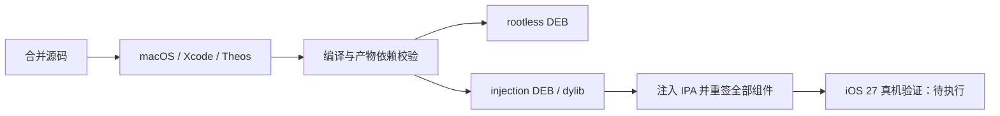

# WeChatEnvBypass 0.2.1

WeChatEnvBypass 的 Theos 构建工程，输出 `.deb` 和适合嵌入 IPA 的独立 `arm64` 动态库。

## 0.2.1 默认值与支持范围

- 扩展功能组的 **54 项 Hook 均默认尝试启用**，包括好友验证字段、设备 IDFV、收据 URL 视图、崩溃监控及安全模式处理。基线清单 55 项中的 `WCAccountControlMgr -onAuthOK` 是纯透传，仍不额外安装。
- 全部 88 项中，按默认开关 **80 项具备初始化条件、8 项关闭**；完整性组 2 项、支付环境组 6 项保持关闭。类/方法不存在或 ABI 不兼容时仍跳过。
- 默认启用不表示已验证防封效果。设备身份、好友验证字段和诊断功能的可见行为相较 0.2.0 会改变。
- **已保存的配置优先于默认值**；曾明确保存为 false 的开关不会被升级强制覆盖。
- 支持的 4 个 Bundle ID 已同步到 loader plist 和运行时白名单：`com.tencent.xin`、`com.tencent.wx`、`com.tencent.qy.xin`、`com.tencent.mm.xin`。这是配置声明的加载范围，不是对 4 个应用版本的实测兼容承诺。
- 应用扩展排除；手动注入到自签、改 ID 的主 App 时，保留主可执行文件名 `WeChat` 的兼容入口。越狱自动加载仍取决于过滤 plist，未加通配符。

**iOS 27：目标待验证。最低部署版本 iOS 15.0，构建成功不代表 iOS 27 真机、微信当前版本或自签名安装已通过。** `.deb` 是插件包，普通未越狱 iOS 不直接安装它；自签名实际签署的是注入插件后的整个 IPA。

## 下载构建产物

打开 [Actions](https://github.com/xiaoye-debug/Wechat/actions/workflows/build.yml)，选择绿色成功的运行，在 Artifacts 下载：

| 产物 | 用途 |
|---|---|
| `WeChatEnvBypass-injection-arm64` | 推荐用于 IPA 注入。含根路径 DEB 与独立 dylib，无 Substrate 依赖 |
| `WeChatEnvBypass-rootless-arm64` | `/var/jb` 布局的 rootless 越狱环境插件包 |

每份产物含 `.deb`、`.dylib`、过滤 plist、偏好配置示例、依赖检查证据与 `SHA256SUMS`。插件使用 Logos `internal` generator，以 Objective-C runtime 安装方法 Hook，不依赖手机上的 Substrate、ElleKit 或 libhooker。它没有 C 函数 Hook。

## 证书自签名注入安装

1. 准备可重签、Bundle ID 在上述白名单中（或重签后主可执行文件仍为 `WeChat`）的 IPA，以及设备可用的 Apple 开发/分发证书及匹配的描述文件。证书、私钥、IPA 均留在本机。
2. 在支持注入的签名工具中导入 IPA，添加 `WeChatEnvBypass-injection.deb`；若工具只支持 dylib，改为添加同目录的 `WeChatEnvBypass.dylib`。两者择一，避免重复加载。
3. 确认工具把动态库嵌入主 App，添加对应的 `LC_LOAD_DYLIB` 加载项，并使用 `@executable_path` 或正确的 `@rpath` 路径。**只把文件复制进 IPA 不会加载插件。**
4. 工具须重新签署动态库、Framework、扩展与主 App，并使用与应用标识、设备、entitlements 匹配的 provisioning profile；越狱构建中的 ad-hoc 签名需要被替换。
5. 安装签名后的 IPA，在系统要求时信任开发者/启用开发者模式。先检查启动、登录、消息、支付与崩溃日志，再确认具体开关行为。

无证书或描述文件时，本仓库仍可构建插件；它不生成可直接安装的已签名 IPA。更改 bundle identifier 可能影响推送、钥匙串、App Groups、扩展及支付能力；这些需要签名工具与描述文件共同匹配。rootless DEB 与 injection DEB 不要同时安装。

## 本地构建（macOS + Xcode + 现成 Theos）

```bash
export THEOS="$HOME/theos"
bash scripts/build.sh injection
bash scripts/build.sh rootless
```

另需 `ldid`、`dpkg-deb`、Python 3，及 Xcode 的 iPhoneOS SDK。CI 在临时 macOS runner 安装构建依赖，Theos 固定到 `8167f59de02fd32cf45b16bfcb1330dfa5c9974c`。输出位于 `dist/injection` 和 `dist/rootless`。

CI 检查真实产物的 arm64 架构、最低 iOS 版本、动态依赖、外部 Hook 符号、Debian 架构、包路径与导出动态库的内容一致性。另检查全部扩展功能组的默认开关、源配置与模板一致性、包内过滤表，并用实际 Objective-C helper 执行 13 项主宿主/扩展白名单测试。rootless 的 `iphoneos-arm64` 与传统根路径的 `iphoneos-arm` 是 Debian 包架构命名；动态库均为 arm64。

## 配置与兼容性

偏好 domain 为 `com.macxk.wcenvbypass`，启动时读取。所有方法保留原源码的存在性和 ABI 检查，未找到或签名不匹配就跳过。未越狱 App 的偏好位于自己的沙盒，不应照搬越狱设备全局 Preferences 路径；示例配置不自动安装。

为避免签名工具忽略过滤 plist 后影响扩展，构造器检查扩展身份，并允许上述 4 个主 App Bundle ID 或主可执行文件名为 `WeChat` 的重签主 App。该检查不是 iOS 27 兼容性证明。插件不保证账号不被限制。

原始 0.2.0 静态覆盖说明见 [历史源码说明](docs/source-0.2.0.md)，其中默认值是旧版本记录；0.2.1 默认值以上述说明、源码和配置模板为准。


