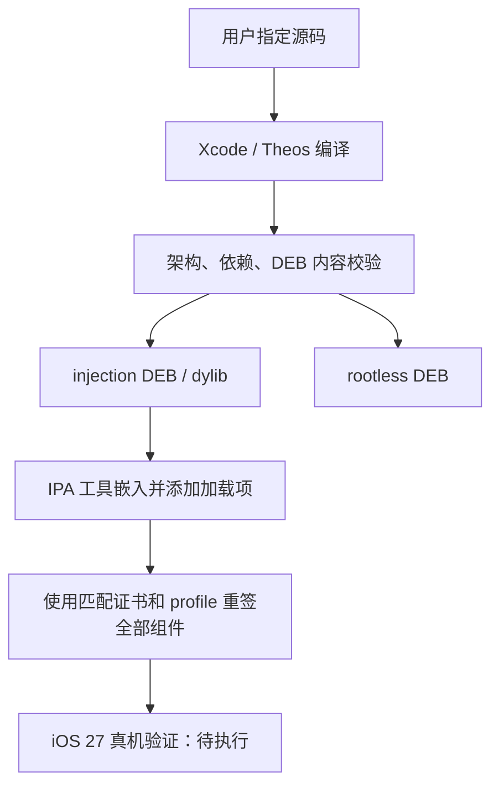

# WeChatEnvBypass 构建交付记录

日期：2026-11-24，Asia/Shanghai。文档采用 docs-generator 的通用报告结构（flavor=null），流程图采用 diagram-generator 的 Mermaid 源码。

## 结果与范围

已将用户指定的 0.2.0 合并源码整理到 [xiaoye-debug/Wechat](https://github.com/xiaoye-debug/Wechat)，并实际使用 GitHub macOS runner 编译。injection 与 rootless 两个版本均完成预处理、编译、链接、strip、ad-hoc 签名、DEB 打包和产物检查，最终工作流状态为 success。两份构建产物已下载至用户工作区并逐项核对 SHA256。iOS 27 真机、用户证书签名、IPA 注入安装、微信当前版本的 Hook 调用及账号状态均未验证。

授权范围是用户提供的源码、指定 GitHub 仓库、构建配置及产物下载。未访问任何手机、微信登录态、IPA、签名私钥或描述文件。操作记录与 scope 保存在本机 `work/wechat-deb-build`，原始交付目录保留。

## 交付变化

- 使用 Theos Logos `internal` generator，替换默认的外部 Substrate Hook 依赖；保留原 88 个独立方法组及 ABI 守卫。
- 输出 arm64 用户态动态库，最低部署版本 iOS 15.0；不把 arm64e 硬件误当成必须构建 arm64e 用户态切片。
- 动态库安装标识使用 `@rpath/WeChatEnvBypass.dylib`，便于 IPA 工具正确嵌入和加载。
- 增加构造器主可执行文件 `WeChat` 检查，避免注入工具忽略过滤 plist 后在扩展中安装 Hook。
- 增加根路径 injection 与 `/var/jb` rootless 两种打包方式，并在同一个 runner 顺序执行。
- 产物检查覆盖架构、最低系统版本、动态依赖、未解析的外部 Hook 符号、Debian 架构、包内路径、过滤 plist 与导出 dylib 的字节一致性。

## 证据 → 发现 → 使用路径

| 证据 | 实际观察 | 可支持的结论 |
|---|---|---|
| [最终构建](https://github.com/xiaoye-debug/Wechat/actions/runs/45214239505) | 完整工作流 success，两种布局的构建、验证、上传均 success | 两种布局均实际编译与打包成功 |
| [已成功的注入任务](https://github.com/xiaoye-debug/Wechat/actions/runs/45213700034/job/137828998697) | 独立任务 success，产物已上传；旧运行整体因替换排队任务而取消 | 注入布局实际编译和检查通过 |
| 下载物中的 `build-evidence.json` | arm64、iOS 15.0、internal generator、系统库依赖、设备验证 false | 构建证据与设备兼容结论分开 |
| 下载物中的 `SHA256SUMS` | 本机逐文件核对 | 下载与构建产物内容匹配 |



## 复现

在已经配置好 Theos、Xcode、ldid、dpkg-deb、Python 3 的 macOS 上：

```bash
export THEOS="$HOME/theos"
bash scripts/build.sh injection
bash scripts/build.sh rootless
```

或者运行仓库 Actions 的 `Build DEB and injection dylib` 工作流。Theos 固定为 `8167f59de02fd32cf45b16bfcb1330dfa5c9974c`；当前实际 runner 使用 Xcode 16.4 / iPhoneOS 18.5 SDK。这是最低 iOS 15.0 的构建，不是使用 iOS 27 SDK 的设备验证。

## 安装边界

普通未越狱系统安装的是重新签名后的 IPA。`.deb` 交给支持插件注入的签名工具，或选择其中的独立 `.dylib`，两者择一。工具必须配置正确的 LC_LOAD_DYLIB 解析路径并重签嵌套代码；只有复制文件不会加载插件。系统签名、entitlements、App Groups、推送及微信自身逻辑仍需用户设备与证书共同验证。

项目 README 提供操作顺序与配置说明；本次不宣称已解决所有微信版本检测或保证账号不受限制。
