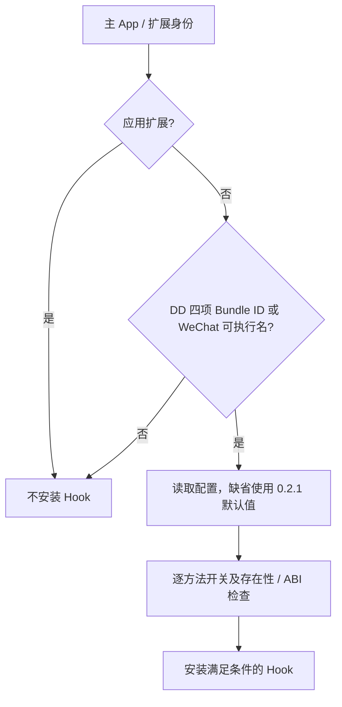

# 0.2.1：DD 默认开关与 Bundle ID 同步

日期：2026-11-24（Asia/Shanghai）。文档按 docs-generator 通用结构整理，流程图使用 diagram-generator 的 Mermaid 源码。

## 变更范围

用户要求把从 DD 迁入的 Hook 全部设为默认开启，并把 DD 原包声明的 Bundle ID 纳入插件支持范围。本次修改只涉及本地构建工程、指定 GitHub 仓库与构建产物；原 0.2.0 交付目录及原始 DD 包保持不变。配置文件中用户已经保存的值仍覆盖新版默认值，不会强制清除用户设置。

## 默认值

同时修改变量初始值、`WCEBLoadConfig` 缺省值和偏好示例，避免配置来源互相矛盾：

| 配置 | 0.2.0 | 0.2.1 | 涉及方法数 |
|---|---|---|---:|
| `HookReportFields` | false | true | 8（3 个字段 setter、5 个好友验证字段 getter） |
| `HookDeviceIdentity` | false | true | 1 |
| `HookReceiptView` | false | true | 1 |
| `HookDiagnosticsSuppression` | false | true | 4 |

其余 DD 分类本已默认开启。迁入的 54 项目前全部满足默认开关条件；`WCAccountControlMgr -onAuthOK` 是原 DD 55 项中的纯透传项，仍不安装额外 Hook。88 项总数保持不变，没有增加或重复方法身份。

默认可尝试初始化的总数为 **80**；来自一刀或头文件的完整性组 2 项及支付环境组 6 项继续默认关闭。运行时仍逐项检查类、方法及 ABI；80 不等于真机安装成功数量，也不等于 80 个独立检测算法。

## Bundle ID 的证据和运行策略

直接解析 DD 原包解出的 `DDAntiBan.plist`，并与既有 XML 解码文件逐项比较，两者一致。原始过滤文件的 SHA256 与 55 项方法身份保存在 `tests/fixtures/dd-contract.json`。

原包过滤表包含：

```text
com.tencent.xin
com.tencent.wx
com.tencent.qy.xin
com.tencent.mm.xin
```

这四项同时写入本插件 loader 过滤 plist 与 `WCEBHostPolicy.h` 的运行时白名单，使用精确匹配，没有添加 `com.tencent.*` 等宽泛通配符。匹配白名单的主 App 不再被固定 `WeChat` 可执行文件名挡住；手动 IPA 注入时，仍允许可执行文件名保持 `WeChat` 的自签改 ID 主 App。扩展通过 `NSExtension` 或 `.appex` 路径排除。

**这是复用 DD 声明的加载范围，不是对应每个应用的真机兼容证明。** 不存在或不匹配的方法会跳过。仅修改 Bundle ID 不会改变签名描述文件、entitlements、推送和 App Groups 的要求。



## Evidence → Finding → Path

| 证据 | 发现 | 后续路径 |
|---|---|---|
| 原始 DD 包过滤与解码 XML 一致 | 四项 ID 确为包内声明，而非按名字猜测 | 同步 loader 和运行时白名单 |
| `scripts/verify_source_contract.py` | 54/54 DD 迁入项默认开启，88 方法身份唯一，80 开启候选 / 8 关闭候选 | 纳入 CI 并随产物保存 `source-contract.json` |
| `tests/host_policy.m` | 对实际 Objective-C helper 测试白名单、重签、扩展、无身份及无通配符情况 | 在 macOS CI 执行 13 项用例 |
| DEB 解包校验 | 核对最终包内的过滤表、版本和动态库内容 | 防止源码改了但打包仍使用旧配置 |
| `tests/test_source_contract.py` | 对二进制、XML、OpenStep 三种过滤格式回归测试 | 支持 Theos 最终包中实际使用的二进制 plist |

## 复现验证

```bash
python3 scripts/verify_source_contract.py
xcrun --sdk macosx clang -fobjc-arc -framework Foundation -I . tests/host_policy.m -o /tmp/wceb-host-policy
/tmp/wceb-host-policy
export THEOS="$HOME/theos"
bash scripts/build.sh injection
bash scripts/build.sh rootless
```

GitHub 构建记录：[0.2.1 成功工作流](https://github.com/xiaoye-debug/Wechat/actions/runs/45223966178)。injection 与 rootless 两种布局的编译、产物校验和上传均为 success；默认值检查、3 项 Python 回归测试（含三种 plist 编码）、13 项 Objective-C 宿主策略用例均通过。两个 artifact 已下载至本机 `编译产物_0.2.1`，14 个清单文件的 SHA256 均匹配。

首次构建已完成编译和打包，但新增校验未识别 Theos 转换后的二进制过滤 plist；已修复解析。之后 ARM 主机排队，切换到标准 `macos-15-intel` runner 后完成构建，产物仍显式指定为 iOS arm64。未执行 iOS 27 真机、IPA 证书重签安装或添加好友场景测试，不宣称解决封号问题。
